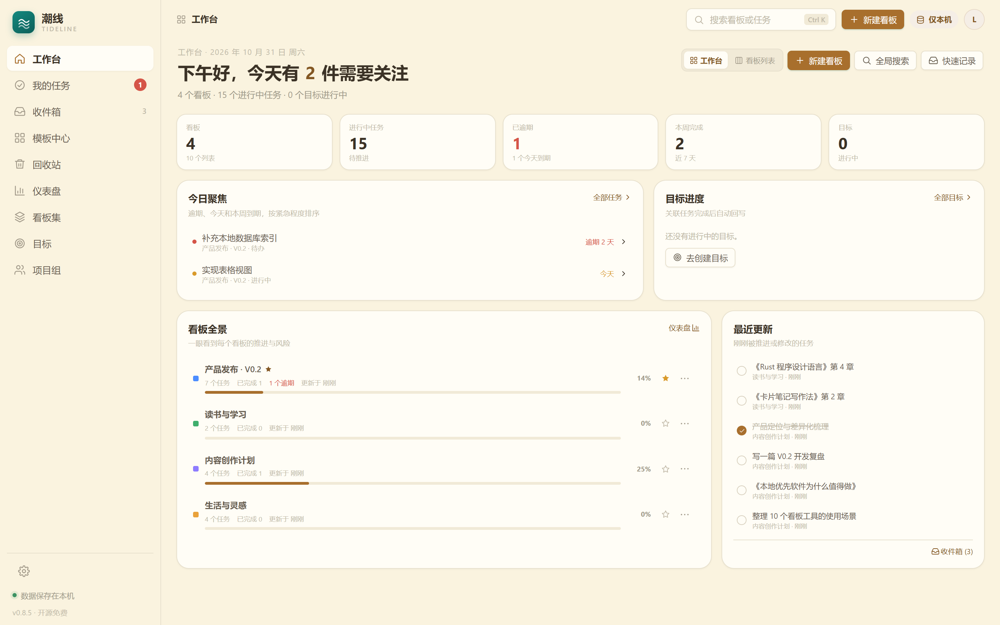
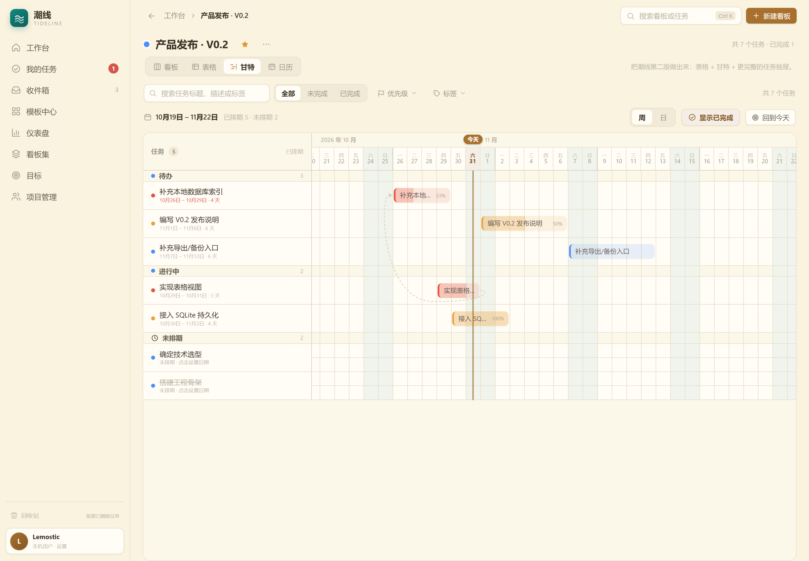
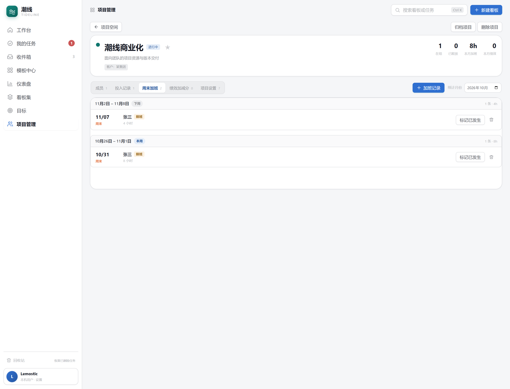

<div align="center">

# 潮线 tideline

**本地优先、开源免费的多视图看板 · 不用账号，数据只属于你**

`Windows 10/11` · `Tauri 2` · `SQLite` · `MIT`

[下载安装](#下载安装) · [功能](#功能) · [界面预览](#界面预览) · [本地开发](#本地开发) · [更新记录](docs/更新记录.md)

</div>

---

潮线是一款面向个人和小团队的 Windows 桌面看板工具。它不要求登录、不依赖网络，也不收集数据：
看板、任务、子任务、目标、项目资源与回收站全部保存在本机 SQLite 文件中，复制即备份，断网也能用。

它不做多人协作、评论、成员权限这类功能，而是把个人任务管理、项目资源台账和多视图排期做扎实。

## 功能

### 日常任务

- **看板视图**：列与卡片原生拖拽，支持跨列移动、同列排序、整列空白处放置；卡片直接展示描述摘要、标签、截止日期、优先级、子任务进度与更新时间。
- **任务详情**：状态、所属列表、起止日期、优先级、前置任务、关联目标、子任务、标签和 Markdown 描述；所有修改自动保存到本地。
- **我的任务**：按「已逾期 / 今天到期 / 本周到期 / 稍后到期 / 无截止日期」自动分组，支持看板筛选、排序与隐藏已完成。
- **收件箱与模板中心**：快速记录想法，一键转为看板任务；内置 14 个真实模板，可预览后一键生成看板。
- **任务依赖与批量操作**：前置任务阻塞提示、循环检测、看板虚线箭头；批量移动、设置优先级、完成或移入回收站。

### 多种视图

| 视图 | 说明 |
| --- | --- |
| **看板** | 列式任务管理，支持卡片强调色、列表颜色与 WIP 上限 |
| **表格** | 按列表分组的三层缩进，子任务可直接勾选，支持行内编辑、排序与搜索 |
| **甘特** | 周/日缩放、今日线、周末底色、任务进度、起止日期/工期与依赖箭头，可拖动改期 |
| **日历** | 6×7 月历，按截止日期归格，支持拖到其它日期改期 |
| **筛选器** | 关键词、完成状态、优先级、标签组合筛选，跨视图保持 |

### 规划与项目资源

- **需求拆解**：粘贴需求文档或读取 `.md` / `.txt`，按 Markdown 标题、编号与缩进解析层级；拆解深度 1–4 层可调，支持「单任务承载子任务」与「按章节拆成多个任务」两种方式，原文段落保留为任务描述，同名任务提前提示。解析全程在本机完成，不经过 AI 服务。
- **工作台**：今日聚焦、目标进度、看板全景、最近更新与快速记录；可切换回顾首页的看板卡片视图。
- **仪表盘**：核心指标、近 7/30/90 天趋势、状态环、优先级分布、看板健康度与重点关注任务。
- **目标**：公司 / 团队 / 个人三层目标树，关联任务后按完成度自动回写进度，支持子目标汇总。
- **看板集**：把多个看板聚合成跨看板任务汇总表，支持筛选、排序、行内完成与成员编辑。
- **项目管理**：多项目空间，自定义角色、元数据、成员多段投入记录、周末加班按周分组、绩效加减分与月度排名。

### 外观与体验

- **10 套主题**：雾蓝白（默认）、板栗鹅黄、科技蓝、简约白、清新绿、薄荷青、海盐蓝、樱花粉、雾紫、竹青；支持自定义主色/强调色/背景/卡片/文字色。
- **全局卡片尺寸**：紧凑 / 标准 / 宽松三档，模板中心、工作台看板卡片与看板集统一引用。
- **全局日期选择器**：月历弹层、今天/清除/手动输入，空值显示「选择日期」占位。
- **Profile 设置入口**：左下角头像与用户名进入设置；回收站作为低频工具入口放在底部，不占用主业务导航。

### 数据与安装

- **本地 SQLite**：WAL 模式，单文件数据库；升级不丢数据，支持自定义数据目录。
- **JSON 备份**：导出全部任务、看板集、目标、项目投入与回收站，恢复前校验结构并单事务替换。
- **系统级安装**：NSIS 简体中文向导，默认安装到 `C:\Program Files\Tideline`，需要管理员权限；旧用户级安装会自动迁移，应用数据保留。
- **更新检查**：可手动检查 GitHub 正式 Release，也可开启启动时检查（每 24 小时一次）；未签名安装包不会静默下载安装。

## 界面预览

| 工作台 | 看板 |
| --- | --- |
|  |  |

| 任务详情 | 甘特视图 |
| --- | --- |
|  |  |

| 项目管理 | 仪表盘 |
| --- | --- |
|  |  |

| 主题外观 | 周末加班按周分组 |
| --- | --- |
|  |  |

## 下载安装

从 [GitHub Releases](https://github.com/Lemostic/tideline/releases/latest) 下载最新的 Windows 安装包：

```
tideline-0.9.0-win64-setup.exe
```

- 系统级安装，默认目录 **`C:\Program Files\Tideline`**，安装/卸载需要管理员权限。
- 旧版用户级安装升级时会自动迁移到 Program Files，无需手动卸载，应用数据不丢失。
- 安装包暂未代码签名，Windows SmartScreen 可能提示；请选择「更多信息 → 仍要运行」。
- 支持 Windows 10/11，WebView2 运行时系统一般已自带。

### 数据在哪里

| 环境 | 位置 |
| --- | --- |
| 安装目录 | `%ProgramFiles%\Tideline` |
| 默认数据库 | `%APPDATA%\com.lemostic.tideline\tideline.db` |
| 自定义数据目录 | 设置 → 数据与存储 → 更改目录；配置在 `%APPDATA%\com.lemostic.tideline\storage.json` |
| 浏览器开发 | localStorage `tideline.db.v1` |

> 数据目录独立于安装目录，升级/卸载程序不会删除数据库。退出应用后复制 `tideline.db` 即可手动备份。

## 本地开发

环境要求：Node.js ≥ 20、pnpm ≥ 9、Rust 稳定版与 MSVC C++ 生成工具。

```bash
pnpm install
pnpm tauri dev                      # 桌面端开发
pnpm dev                            # 浏览器开发（http://127.0.0.1:5173）
pnpm test                           # Vitest
pnpm typecheck                      # TypeScript
pnpm tauri build --bundles nsis     # Windows NSIS 安装包
```

前端 React 18 + TypeScript + Vite 6 + Zustand 5，后端 Tauri 2 + Rust + rusqlite，前后端通过 56 个命令通信，接口契约在 [`src/lib/api.ts`](src/lib/api.ts)。

```text
src/
  components/     通用组件：侧边栏 / 顶栏 / 弹窗 / 任务详情 / 日期选择器
  features/       board（看板·表格·甘特·日历·筛选）/ tasks
  pages/          工作台 / 我的任务 / 收件箱 / 目标 / 仪表盘 / 项目管理等
  store/          appStore / uiStore / settingsStore / updateStore
src-tauri/        Tauri 配置、Rust 命令、SQLite 迁移、NSIS 安装器
docs/             开发计划 / 版本规划 / 发布说明 / 更新记录
```

测试：Vitest 93 项、Rust `cargo test` 69 项、Playwright E2E（本地运行）。完整数据模型与验收标准见 [`docs/开发计划.md`](docs/开发计划.md)。

## 已知限制

- 不提供多人协作、评论、@成员、通知等团队功能；项目管理只是单机资源台账，不同步任何数据。
- 自定义数据目录仅桌面端支持；浏览器开发模式仍使用 localStorage。
- 偏好设置不随 JSON 备份导出/恢复；数据目录配置独立保存在 `storage.json`。
- 看板/列表删除为硬删除，任务删除支持回收站；目前仅在 Windows 上构建验证。

## 更新记录

| 版本 | 变更 |
| --- | --- |
| **V0.9.0** | 新增「需求拆解」：需求文档一键拆成看板任务与子任务，深度与拆解方式可调 |
| V0.8.16 | 系统级安装到 Program Files，自动迁移旧用户级安装，应用数据保留 |
| V0.8.15 | 周末加班按周分组；全局日期选择器替换原生日期输入 |
| V0.8.14 | 全局卡片尺寸配置，模板中心与工作台卡片统一 |
| V0.8.13 | 新增「雾蓝白」默认主题 |
| V0.8.12 | 新增薄荷青、海盐蓝、樱花粉、雾紫主题 |

[查看完整更新记录 →](docs/更新记录.md)

## License

[MIT](LICENSE) © 2026 lemostic
